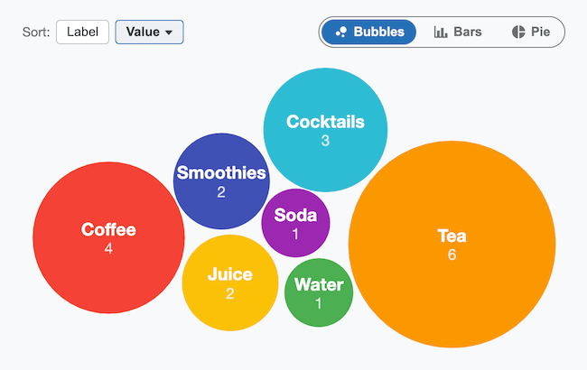
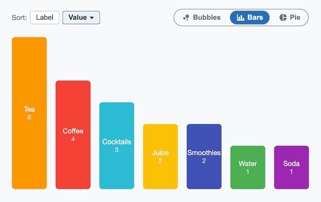
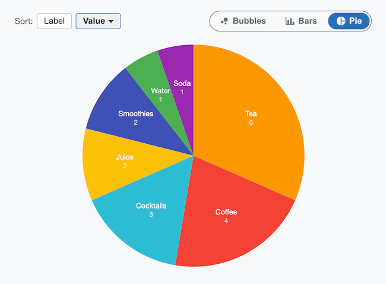

# React-Morph-Charts

A reusable React/TypeScript component that displays data as a **bubble
chart**, **bar chart**, or **pie chart**, with animated morphing
transitions between views, on hover, and on window resize.

Check out the [Demo](https://evoluteur.github.io/react-morph-charts).










The layout and morphing algorithm — spiral-packed bubbles relaxed into a
cluster, `clip-path`-based wedges for the pie, and CSS `transform`
transitions shared across all three views — is a generalized port of the
topic visualization on [evoluteur-blog](https://github.com/evoluteur/evoluteur-blog)'s
`/topics` page.

## Install

```bash
npm install react-morph-charts
```

## Usage

```tsx
import MorphCharts from "react-morph-charts";
import "react-morph-charts/style.css";

const data = [
  { id: "coffee", label: "Coffee", value: 4 },
  { id: "tea", label: "Tea", value: 6 },
  { id: "juice", label: "Juice", value: 2 },
  // ...
];

function App() {
  return (
    <MorphCharts
      data={data}
      onItemClick={(item) => console.log("clicked", item)}
    />
  );
}
```

The component renders its own toolbar (a Bubbles/Bars/Pie view toggle and a
light/dark/omg theme toggle) above the chart, so it works as a drop-in,
self-contained widget.

## Props

| Prop          | Type                                                | Required | Description                                                                 |
| ------------- | ---------------------------------------------------- | -------- | ----------------------------------------------------------------------------- |
| `data`        | `Array<{ id?, label, value, color?, sublabel? }>`    | yes      | Items to display. `id` is optional; when omitted, `label` is used as the item's identity, so `label` should be unique. `value` drives bubble/bar size and pie slice angle. |
| `disabled`    | `boolean`                                            | no       | When `true`, dims the component and disables view toggling and `onItemClick`. Defaults to `false`. |
| `className`   | `string`                                             | no       | Extra class name(s) applied to the root element. |
| `onItemClick` | `(item, event) => void`                              | no       | Called when an item is clicked or activated via keyboard. Also toggles the item's active/highlighted state. |

### Additional (optional) props

These have sensible defaults and don't need to be set for typical use:

| Prop              | Type                                  | Default      | Description                          |
| ------------------ | -------------------------------------- | ------------ | -------------------------------------- |
| `defaultView`       | `"bubbles" \| "bars" \| "pie"`         | `"bubbles"`  | Initial view.                          |
| `view`              | `"bubbles" \| "bars" \| "pie"`         | —            | Controls the view externally. Omit to let the component manage its own view state (uncontrolled). |
| `onViewChange`      | `(view) => void`                       | —            | Called whenever the view changes (controlled or uncontrolled). |
| `showViewToggle`    | `boolean`                              | `true`       | Set to `false` to hide the built-in Bubbles/Bars/Pie toggle. |
| `formatValue`       | `(value: number) => string`            | `String`     | Formats each item's value shown under its label. |
| `palette`           | `string[]`                             | 7-color default | Colors cycled for items without an explicit `color`. |
| `minSize`           | `number`                               | `60`         | Baseline bubble diameter, in pixels, before `value` is added in. |
| `barMinHeight`      | `number`                               | `40`         | Minimum bar height, in pixels, before `value` is added in (bars view). |
| `valueScale`        | `number`                               | `40`         | Pixels added per unit of `value` to a bubble's diameter or a bar's height. |
| `gap`               | `number`                               | `6`          | Gap between bubbles, in pixels (bubbles view). |
| `barGap`            | `number`                               | `16`         | Gap between bars, in pixels (bars view). |
| `barMaxWidth`       | `number`                               | `80`         | Maximum bar width, in pixels (bars view). |
| `pieMaxRadius`      | `number`                               | `170`        | Maximum pie radius, in pixels (pie view). |
| `theme`             | `"light" \| "dark" \| "omg"`           | —            | Controls the theme externally. Omit to let the component manage its own theme state (uncontrolled). |
| `defaultTheme`      | `"light" \| "dark" \| "omg"`           | system preference | Initial theme when uncontrolled and nothing is in `localStorage` yet. |
| `onThemeChange`     | `(theme) => void`                      | —            | Called whenever the theme changes (controlled or uncontrolled). |
| `themeStorageKey`   | `string`                               | —            | When set, the chosen theme is persisted to `localStorage` under this key and restored on mount. Off by default so the component doesn't write to storage unasked. |
| `showThemeToggle`   | `boolean`                              | `true`       | Set to `false` to hide the built-in theme toggle (e.g. if the host page drives `theme` itself). |

## Theming

The component ships with three themes — **light**, **dark**, and **omg** —
toggled with the same three-icon control (sun / moon / spiral) used by
[react-morph-table-cards](https://github.com/evoluteur/react-morph-table-cards),
rendered at the top right of the toolbar.

Theming is scoped to the component via a `data-theme` attribute on the root
`.rmc` element — it never touches `document.documentElement` — so it's
safe to drop into a page that has its own theming system. Colors are driven
by CSS custom properties (`--rmc-bg`, `--rmc-panel-bg`, `--rmc-text`,
`--rmc-text-secondary`, `--rmc-border`, `--rmc-primary`, `--rmc-toggle-bg`),
overridable per theme via `.rmc[data-theme="..."]` if you want to restyle
or add a theme.

## Styling

Each item's fill color comes from its own `color`, or otherwise cycles
through the `palette` prop (a 7-color default, unaffected by theme).
Override the `--rmc-accent` custom property per item, or pass a custom
`palette`, to customize appearance.

## Local development

```bash
npm install
npm run dev      # runs the demo app in ./demo
npm run build    # builds the library to ./dist
```

## License

React-Morph-Charts is released under the MIT license.

Encourage this project by becoming a [sponsor](https://github.com/sponsors/evoluteur).

You may want to also check out [React-Morph-Table-Cards](https://github.com/evoluteur/react-morph-table-cards), a similar project for animated transitions between table and cards views.

(c) 2026 [Olivier Giulieri](https://evoluteur.github.io/).
